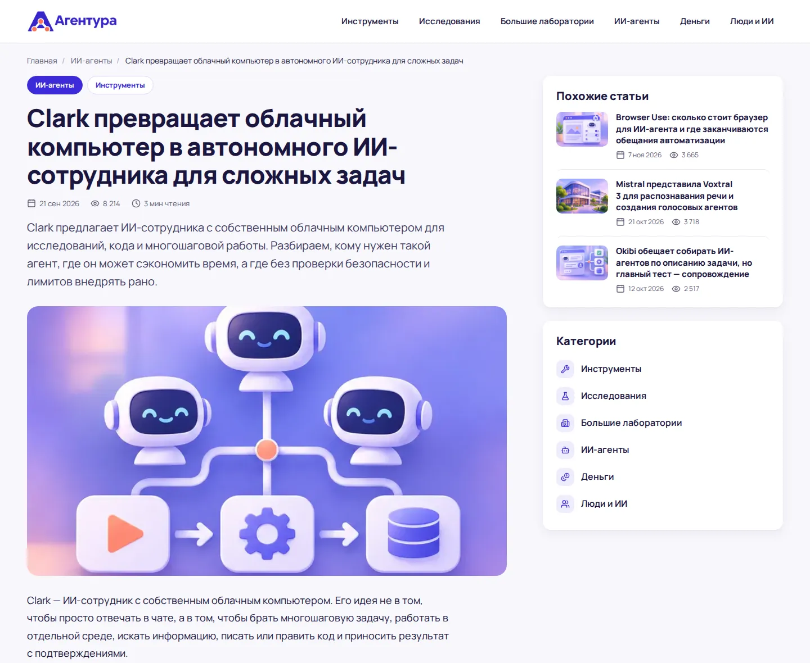
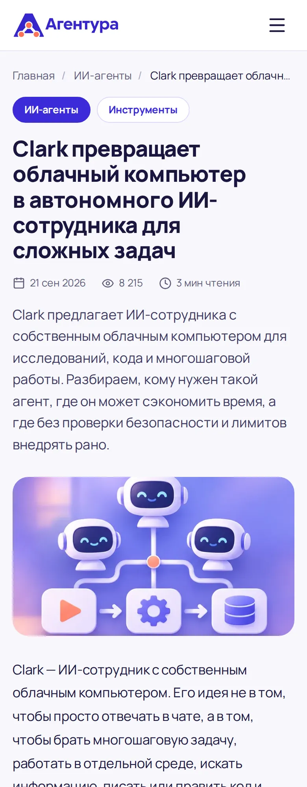

# Агентура - блог об ИИ на PHP, Smarty и MySQL

[](https://github.com/Gegirhasut/php-smarty-blog/actions/workflows/ci.yml)

Тестовое задание: блог с категориями и статьями на чистом PHP без фреймворков, шаблоны Smarty, база MySQL.
Главная с тремя свежими статьями каждой категории, категория с сортировкой и пагинацией, статья с просмотрами
и похожими статьями, сидер категорий и статей.

**Демо:** адрес появится после деплоя на Render.




<p>
  
  
</p>

Остальные снимки - в [docs/screenshots](docs/screenshots).

## Запуск

Нужен Docker.

```bash
docker compose up -d --build
docker compose exec php php bin/seed.php --fresh
```

Сайт - http://localhost:8080. Порт и доступ к базе можно поменять в `.env` (образец - `.env.example`).

## Тесты и анализ

```bash
docker compose exec php composer test      # PHPUnit: unit, интеграционные на MySQL, функциональные
docker compose exec php composer analyse   # PHPStan, уровень max
```

CI на GitHub Actions: PHPStan и PHPUnit на PHP 8.1 и 8.5 с MySQL 8.4, сборка SCSS, сборка и запуск образа демо.

## Стек

PHP 8.5 (код совместим с 8.1), Smarty 5, MySQL 8.4, nginx, SCSS (dart-sass), Docker Compose; PHPUnit и PHPStan - только для разработки.

## Структура

- `public/index.php` - единственная точка входа; `src/Core` - приложение, роутер, запрос и ответ, обёртка над Smarty.
- `src/Controller` - тонкие контроллеры, `src/Repository` - весь SQL, `src/Blog` - сущности и правила блога без SQL и HTTP.
- `src/Seo` - мета-теги и JSON-LD, sitemap, RSS, llms.txt; `src/Database` и `src/Seed` - подключение, схема, сидер.
- `templates` - шаблоны Smarty, `assets/scss` - стили, `database` - схема и данные сидера.
- `tests` - unit, интеграционные и функциональные тесты.
- `docker` - nginx для разработки и образ демо, `docs` - документация.

## Документация

- [Архитектура](docs/architecture.md) - путь запроса, слои, ключевые решения, тесты.
- [База данных](docs/database.md) - схема, индексы, запросы, сидер.
- [Как использовался ИИ](docs/ai.md)
- [План работы](docs/plan.md) - этапы и решения по ним.

## Демо на Render

Образ «всё в одном» (`docker/demo`): nginx, php-fpm и MySQL 8.4 в одном контейнере - под бесплатный план Render
с одним сервисом и 512 МБ памяти. Чтобы развернуть: Render → New → Blueprint → этот репозиторий, настройки - в `render.yaml`.

- Данные эфемерные: при каждом старте база создаётся заново и заполняется сидером, просмотры обнуляются.
- Бесплатный сервис засыпает после 15 минут без запросов. Первый запрос его будит - это до минуты: Render поднимает
  контейнер, затем около 20 секунд стартуют MySQL и сидер.
- Локально: `docker build -f docker/demo/Dockerfile -t blog-demo .`,
  затем `docker run --rm -p 8080:10000 -e APP_URL=http://localhost:8080 blog-demo`.
